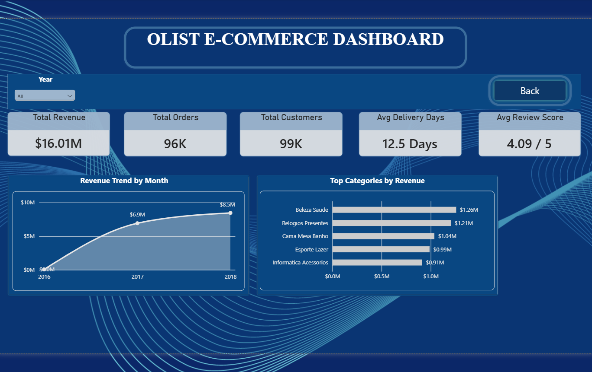

# Olist E-Commerce Sales & Customer Analytics Dashboard

## Project Overview

This project analyzes Olist e-commerce data using Power BI to understand sales performance, customer behavior, and regional business performance.

## Objectives

* Analyze total sales and revenue.
* Track total orders and average order value.
* Compare sales performance across states.
* Understand customer and order trends.
* Identify useful business insights through interactive dashboards.

## Tools & Technologies

* Power BI
* Power Query
* DAX
* Data Cleaning
* Data Modeling
* Data Visualization

## Key Performance Indicators (KPIs)

* Total Revenue
* Total Orders
* Average Order Value
* Customer Count
* Delivery Performance

## My Contribution

* Cleaned and transformed the data using Power Query.
* Created relationships between tables.
* Developed DAX measures for business KPIs.
* Designed interactive dashboards and visualizations.
* Analyzed sales and revenue performance across states.

## Dashboard Screenshots

## Dashboard Preview

### 1. Olist Dashboard

### 2. Product Analysis

### 3. Region Analysis

### 4. Delivery Analysis

### 5. Landing Page

### 6. Decomposition Tree

## Project File

The Power BI dashboard file (`.pbix`) is included in this repository, subject to GitHub's file size limit.

## Key Learnings

* Data cleaning and transformation
* Data modeling in Power BI
* DAX calculations
* KPI development
* Business data analysis and visualization
